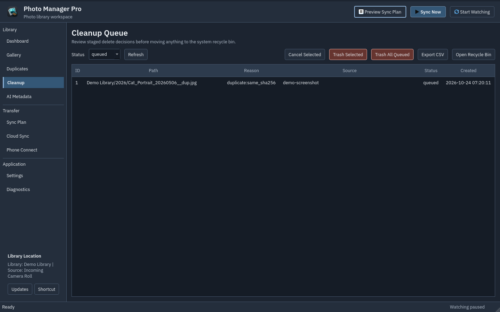
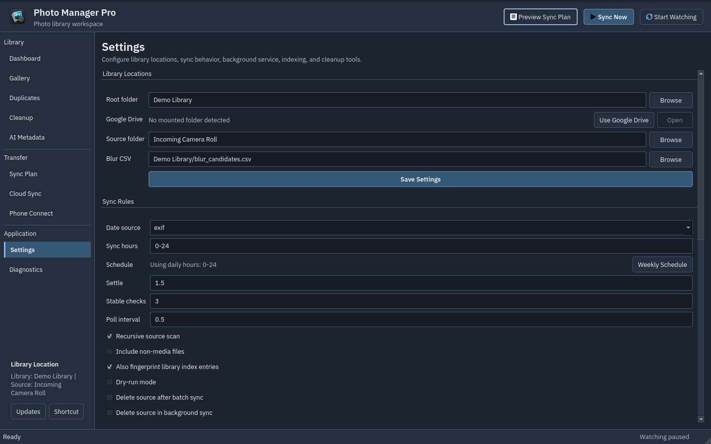
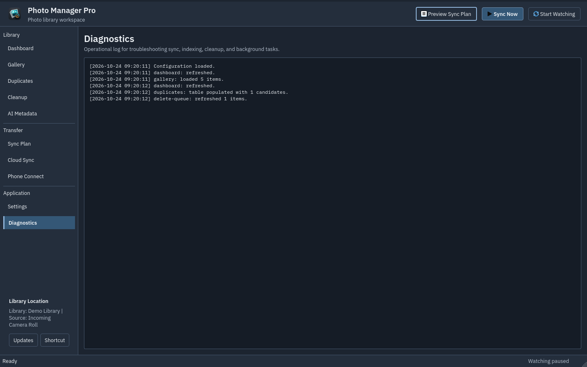

# Screenshot guide

README, documentation and GitHub Pages use real captures of the current Qt
workspace. These images show the unreleased development interface, not the
interface included in the downloadable 0.2.1 release.

## Shared originals

All six PNGs below come from the same capture session at 1440×900. The README
uses these exact files through repository-relative links, so its branch preview
and the repository home page after merge show the committed design.


<details>
<summary>Cleanup, settings and diagnostics</summary>







</details>

## Regenerate and verify

From the repository root, with Qt, Pillow and Chromium available:

```bash
QT_QPA_PLATFORM=offscreen python scripts/capture_demo_screenshots.py
python scripts/build_site_images.py
python scripts/check_site.py
SITE_SCALE=2 python scripts/check_site.py
```

The capture script isolates configuration, disables autostart and uses only the
bundled public-domain demo photographs. Never capture private photos, credentials
or personal paths. It writes six PNGs and a manifest containing source and image
SHA256 hashes. The image builder derives 640/960/1440 px WebPs and the inline hero
from those PNGs; it does not create a separate UI mockup.

Commit the updated PNGs, manifest, WebPs and `docs/index.html` together. Keep README
links relative to the repository root and this guide's links relative to `docs/`.
Do not link screenshots to `main`, old tags or release assets: those would show the
wrong version in a PR preview. `check_site.py` validates local Markdown images and
requires README and this guide to reference the complete canonical PNG set.

CI checks the committed files before capturing its own Pages images. A Pages build
alone cannot update images stored in Git: README and this guide change when the PR
is merged; the public website changes after the subsequent Pages deployment.
Existing release assets and PyPI packages are not modified by this process.

For layout review, also capture 1120×720 and 1920×1080 logical windows, including
Qt 2× scaling, to a separate output directory. Inspect actual images before
publishing; keep the canonical shared originals at 1440×900.
